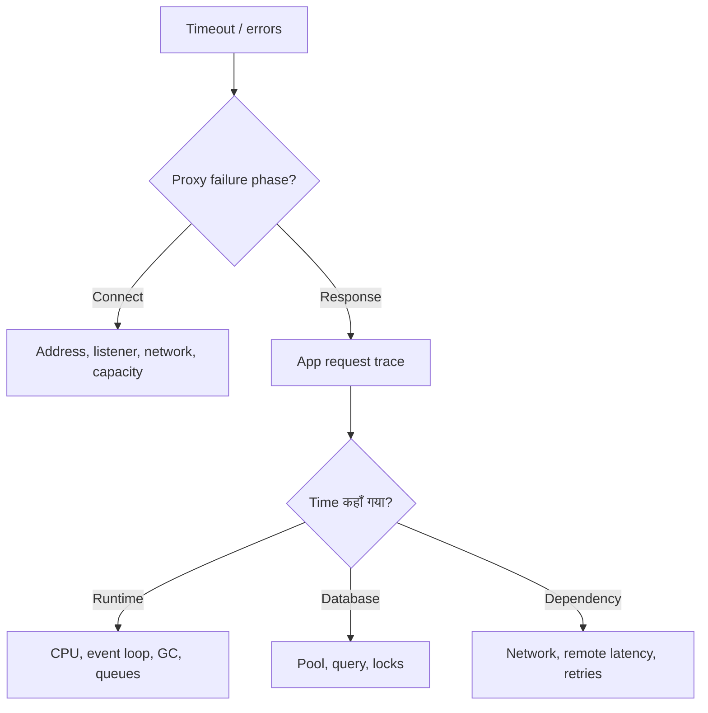

# Production Incident Debugging — Step-by-step Q&A

Updated: 2026-11-04

यह reference हमारी production incident debugging discussion पर आधारित है। Nginx/PostgreSQL वाले examples discussion से हैं; downstream, runtime और recovery sections उसी process का extension हैं। सभी timings और limits illustrative हैं, production defaults नहीं।

## Contents

1. [Incident शुरू कैसे करें?](#1-incident-शुरू-कैसे-करें)
2. [Load balancer और network](#2-load-balancer-और-network)
3. [Application layer](#3-application-layer)
4. [Database connection pool](#4-database-connection-pool)
5. [Database queries और locks](#5-database-queries-और-locks)
6. [Timeouts और Redis TTL](#6-timeouts-और-redis-ttl)
7. [Downstream services](#7-downstream-services)
8. [पूरी worked incident](#8-पूरी-worked-incident)
9. [Recovery और future reference](#9-recovery-और-future-reference)
10. [Official references](#10-official-references)

## 1. Incident शुरू कैसे करें?

### Q1. Production में requests timeout हो रही हैं। पहला कदम क्या है?

पहले impact और timeline establish करो:

- कब शुरू हुआ? क्या उसी समय deployment, config change, migration या scheduled job चला?
- कौन से endpoints, tenants, regions और instances affected हैं?
- Total traffic, errors और p50/p95/p99 latency में क्या बदला?
- सभी requests fail हैं या कुछ slow हैं? Read और write दोनों affected हैं?
- एक failed request का request ID / trace ID और timestamp लो।

फिर उसी request को edge → proxy → app → DB/downstream तक trace करो। हर layer पर पूछो: **request यहाँ पहुँची? कितना समय लगा? अगली dependency पर कहाँ wait हुआ?**

Investigation sequentially समझाई गई है; severe incident में impact mitigation और evidence collection साथ चल सकते हैं।

### Q2. Debugging का overall map क्या है?



यह topology एक guide है। हर incident हर layer से होकर नहीं जाता; evidence जिस branch में ले जाए, वहाँ आगे बढ़ो।

### Q3. क्या 504 देखकर DB slow मान सकते हैं?

नहीं। 504 gateway के इंतज़ार की failure दिखाता है। कारण backend connection failure, app queue, pool wait, query, downstream call या network हो सकता है। 502 भी अकेले root cause नहीं बताता; proxy का exact error और upstream details देखो।

## 2. Load balancer और network

### Q4. Nginx error में सबसे useful distinction क्या है?

| Log phase | अभी क्या पता है? | अगला check |
| --- | --- | --- |
| `while connecting to upstream` | Upstream connection establish होने की phase fail हुई | Target address, listener, network path, connection capacity |
| `while reading response header from upstream` | Connection बना, लेकिन response headers समय पर पूरे नहीं मिले | App trace, processing/waits, return network path |
| `while reading upstream` | Response पढ़ते समय delay/failure | Streaming/body generation, downstream, buffers/network |

HTTPS upstream में connection setup में TLS भी relevant हो सकता है। Error phase app handler execution की पूरी कहानी नहीं बताती।

### Q5. Connecting timeout आए तो किस order में check करें?

1. Error log का exact upstream IP/port actual service target से मिलाओ।
2. Backend पर confirm करो कि सही interface और port पर service listen कर रही है।
3. Nginx की machine/container/network namespace से उसी target तक test करो।
4. Routing, firewall/security groups, Kubernetes Service/Endpoint और NetworkPolicy inspect करो जहाँ applicable हों।
5. यदि failure सिर्फ load पर है, accept backlog, FD limits और connection churn/saturation देखो।

अपने laptop से successful connection Nginx → backend path को prove नहीं करता।

```bash
# Backend host/container: listening sockets
ss -lntp

# Nginx वाली execution/network environment से; example private address
nc -vz -w 3 10.0.2.15 8080

# Harmless HTTP endpoint; health endpoint business route का substitute नहीं है
curl --connect-timeout 3 --max-time 5 -v http://10.0.2.15:8080/health
```

इन commands के tools/permissions environment पर depend करते हैं। Single successful probe intermittent failure को rule out नहीं करता।

### Q6. Connection refused और timeout में क्या फर्क है?

**Refused:** आम तौर पर target पर listener नहीं मिला या किसी network device/firewall ने actively reject किया। Wrong port, crashed process और wrong bind address common checks हैं।

**Timeout:** समय के भीतर setup पूरा नहीं हुआ। Packet drop, routing, unavailable host, backlog pressure आदि possibilities हैं।

Queue भर गई है, यह केवल इन messages से conclude मत करो। Socket/queue metrics और आवश्यकता पर packet evidence से confirm करो।

### Q7. Backend `127.0.0.1:8080` पर listen कर रहा है और Nginx दूसरी machine पर है। समस्या क्या है?

Backend केवल अपने loopback interface पर सुन रहा है। Nginx अगर backend का private IP use करे तब भी वहाँ listener नहीं मिलेगा।

दो configuration checks अलग हैं:

- Nginx का `localhost` Nginx की अपनी machine/network namespace है।
- Backend का केवल loopback पर bind होना remote connections स्वीकार नहीं करता।

Backend को intended private interface पर bind करो, या architecture के हिसाब से `0.0.0.0` पर with appropriate network access controls। Nginx को reachable backend address दो। Same host पर भी अलग containers के localhost अलग हो सकते हैं।

### Q8. Backend listen कर रहा है। क्या service healthy साबित हो गई?

नहीं। Listener होना business request process होने की guarantee नहीं है। App queue, event loop, DB और dependencies फिर भी stuck हो सकते हैं। Probe उसी path/context से करो, और affected endpoint की trace देखो।

### Q9. Nginx में कौन सी timings useful हैं?

`$request_time`, `$upstream_connect_time`, `$upstream_header_time`, `$upstream_response_time`, `$upstream_addr`, `$upstream_status` और request ID capture करो।

Connect time high हो तो setup branch; connect fast लेकिन headers late हों तो upstream response branch investigate करो। ये values cumulative/phase-specific हैं; इन्हें blindly जोड़ना सही नहीं। Upstream retries होने पर multiple attempts की values आ सकती हैं। Proxy buffering और slow client भी total request time को प्रभावित कर सकते हैं।

## 3. Application layer

### Q10. Nginx 30 seconds पर timeout देता है; app का start log तुरंत है, completion log नहीं। क्या निष्कर्ष है?

Request app तक पहुँची और completion observe नहीं हुई। App execution या dependency wait investigate करना उचित है। Missing completion log अपने आप root cause नहीं: process crash, logging gaps या response/network issue भी check करो।

Same request/trace ID से evidence correlate करो; approximate timestamps वाली अलग requests मत मिलाओ।

### Q11. Application timing कैसे तोड़ें?

Trace spans या monotonic-clock timing logs लगाओ:

| Phase | क्या measure करें? |
| --- | --- |
| Admission/runtime | Worker queue और handler start delay |
| DB pool | Connection माँगने से मिलने तक |
| DB work | Query/transaction duration |
| External call | DNS/connect/TLS, response और retries |
| Local work | CPU processing, serialization |
| Completion | Response write/finish/close |

Sequential phases के durations total समझाने में मदद करते हैं। Parallel spans को जोड़ने के बजाय critical path देखो। Connection मिलने से release होने तक का **hold time** भी measure करो।

### Q12. CPU normal है तो app healthy है?

नहीं। App DB pool, lock, network या worker queue पर wait कर सकती है और CPU low रह सकता है। Instance averages CPU throttling या किसी एक busy thread/core को छिपा सकते हैं।

| Signal | अगला evidence |
| --- | --- |
| High CPU / event-loop lag | CPU profile, sync work, serialization, hot loops |
| GC pauses / memory rise | Heap/RSS, allocation rate, retained objects |
| Low CPU + high latency | Pool queues, locks, I/O/downstream waits |
| Restarts/OOM | Container termination reason, memory limits, process logs |
| Timeouts + disk pressure | Disk space/inodes, I/O latency, logging failures |

Healthy Kubernetes pod status भी endpoint latency की guarantee नहीं।

### Q13. Query 100 ms है, लेकिन connection लेने में 25 s। Slow query है?

उस request की measured query तेज़ है; मुख्य delay **pool acquisition** में है। अभी app pool के busy connections inspect करो। दूसरी requests long queries/transactions चला सकती हैं, इसलिए एक fast query से पूरे DB को healthy मत मानो।

## 4. Database connection pool

### Q14. Pool size 20 है और सभी busy हैं। नई request क्या करेगी?

आम तौर पर bounded/unbounded pool queue में wait करेगी, या driver policy के अनुसार reject होगी। Acquisition timeout होने पर fail होगी। Asynchronous waiting से CPU बढ़ना आवश्यक नहीं, लेकिन queued requests memory और latency बढ़ाती हैं।

### Q15. Pool की कौन सी metrics चाहिए?

- Configured maximum और actual total connections।
- Checked-out/busy तथा idle/available connections।
- Pending acquisition queue।
- Acquisition latency और timeout count।
- Connection hold duration; leaks और error-path cleanup।

**Pool maximum अकेले saturation prove नहीं करता।** Driver metric names अलग होते हैं; app के checked-out connection पर DB session idle भी दिख सकता है।

### Q16. Pool full क्यों हुआ?

| Hypothesis | Confirm कैसे करें? |
| --- | --- |
| Slow queries | Query latency, plans, DB CPU/I/O |
| Lock contention | Wait events और blocker graph |
| Long transaction | Transaction age, app trace |
| Connection leak | Requests खत्म होने के बाद भी checked-out count high |
| External call while holding connection | Hold span में downstream wait |
| Traffic/batch spike | RPS, endpoint mix, job concurrency |
| DB connection setup problem | New connection errors, DB connection budget |

### Q17. Pool size बढ़ाना immediate fix है?

पहले DB headroom और total connection budget देखो। Example: 10 replicas × pool maximum 20 = 200 संभावित connections, इसके अलावा jobs, migrations, admin और rollout replicas।

Already overloaded DB पर अधिक concurrency latency बढ़ा सकती है। Connection leak या long transaction भी pool बढ़ाने से ठीक नहीं होते। जरूरत के हिसाब से concurrency घटाना, expensive job pause करना, transaction छोटा करना या bounded admission देना बेहतर mitigation हो सकता है।

### Q18. App code में क्या देखेंगे?

Connection हर success/error/cancellation path पर release हो; explicit transaction error पर rollback हो। ORM transaction API की semantics समझो। Connection/transaction hold करते हुए unnecessary HTTP calls या sleeps मत रखो। Pool को unhealthy/aborted connection लौटाने के बजाय driver की cleanup/discard policy follow करो।

## 5. Database queries और locks

### Q19. PostgreSQL में sessions और timings कैसे देखें?

Read-only diagnostic query:

```sql
SELECT
    pid,
    application_name,
    client_addr,
    state,
    clock_timestamp() - xact_start AS transaction_age,
    CASE WHEN state = 'active'
         THEN clock_timestamp() - query_start
    END AS active_query_age,
    clock_timestamp() - state_change AS state_age,
    wait_event_type,
    wait_event,
    pg_blocking_pids(pid) AS blocking_pids,
    left(query, 500) AS query_sample
FROM pg_stat_activity
WHERE datname = current_database()
  AND backend_type = 'client backend'
  AND pid <> pg_backend_pid()
ORDER BY xact_start NULLS LAST;
```

Other sessions की full visibility के लिए suitable monitoring privileges चाहिए। Query text में sensitive values हो सकती हैं; incident notes में redact करो।

`active` state के साथ wait event होना possible है। Idle session में `query` last statement है; इसका मतलब वह statement अभी execute हो रहा है ऐसा नहीं।

### Q20. कौन किसको block कर रहा है?

```sql
SELECT
    w.pid AS waiting_pid,
    b.pid AS blocking_pid,
    w.wait_event_type,
    w.wait_event,
    clock_timestamp() - w.query_start AS waiter_statement_age,
    clock_timestamp() - b.xact_start AS blocker_transaction_age,
    b.state AS blocker_state,
    b.application_name AS blocker_app,
    left(w.query, 300) AS waiting_query,
    left(b.query, 300) AS blocker_current_or_last_query
FROM pg_stat_activity AS w
CROSS JOIN LATERAL unnest(pg_blocking_pids(w.pid)) AS p(blocker_pid)
JOIN pg_stat_activity AS b ON b.pid = p.blocker_pid
WHERE w.datname = current_database();
```

यह ordinary session blockers के लिए useful है। Prepared transaction जैसे special blockers के लिए अलग inspection चाहिए। Large systems में इन diagnostics को aggressive tight polling में मत चलाओ।

### Q21. Blocker एक UPDATE है जो दो मिनट से दिख रहा है। अगला सवाल?

1. Statement अभी running है या session `idle in transaction` है?
2. Transaction कब शुरू हुई?
3. कौन सा endpoint/job और tenant इसे चला रहा है?
4. कौन सी table/business record और कितने waiters impacted हैं?
5. Query execution, lock wait या external work में समय गया?
6. क्या app ने commit/rollback करना छोड़ दिया?

Current/last query हमेशा वही statement नहीं जिसने पहले lock लिया था। Transaction के earlier statements भी देखो। Exact blocked row हर बार `pg_stat_activity` से नहीं मिलती; `pg_locks`, query parameters और app trace की जरूरत हो सकती है।

### Q22. Long query और long transaction अलग कैसे हैं?

Query 100 ms में खत्म हो सकती है, लेकिन transaction open रहने पर उसके locks बने रह सकते हैं। Example: UPDATE → external payment API → COMMIT। API 30 s ले तो lock उसी दौरान held रह सकता है।

इसलिए active statement age, transaction age और app connection hold duration अलग measure करो।

### Q23. Background job safely retry हो सकती है। Terminate कर दें?

User impact, exact PID/job identity, transaction scope, rollback cost और external side effects verify करो। जरूरत हो तो job/retries pause या throttle करो ताकि वही contention वापस न आए।

- Query cancel current statement रोकता है; session open रहती है। Explicit transaction में rollback/cleanup की जरूरत हो सकती है।
- Session terminate connection खत्म करता है; uncommitted transaction abort होती है और locks cleanup के साथ release होते हैं।
- पहले committed DB changes या external API side effects termination से undo नहीं होते।
- Idle-in-transaction session पर query cancel पर्याप्त नहीं हो सकता।

Inspection के बाद ही targeted admin action चुनो। Reference syntax, runnable incident automation नहीं:

```sql
-- Replace the placeholder only after identifying the exact backend.
-- SELECT pg_cancel_backend(<verified_pid>);
-- SELECT pg_terminate_backend(<verified_pid>);
```

Recovery assume मत करो; blocker disappearance, lock waits, pool queue और user errors दोबारा check करो।

### Q24. Permanent fix क्या होगा?

Cause के अनुसार short transactions, smaller batches, appropriate indexes, consistent lock order, bounded job concurrency, guaranteed rollback/release और timeout/cancellation handling। External calls को transaction से निकालते समय correctness redesign करो: durable state machine/outbox और idempotency जैसे patterns जरूरत पड़ सकते हैं।

## 6. Timeouts और Redis TTL

### Q25. कौन सा timeout क्या limit करता है?

| Timeout | किसका इंतज़ार/काम bound होता है? | क्या नहीं करता? |
| --- | --- | --- |
| Pool acquisition | App pool से connection मिलना | DB query cancel नहीं करता |
| DB connection setup | नया DB connection establish करना | Existing pool queue की हर wait नहीं |
| PostgreSQL lock_timeout | हर lock acquisition पर wait | दूसरे holder का lock expire नहीं करता |
| PostgreSQL statement_timeout | एक statement का total time, lock wait सहित | पूरे multi-statement transaction का shared budget नहीं |
| idle_in_transaction_session_timeout | Open transaction में idle client session | Actively running query की general limit नहीं |
| PostgreSQL transaction_timeout | Supported versions में transaction duration | सभी deployed versions में available नहीं |
| HTTP client deadline | Remote operation का allowed time | Remote side effect rollback की guarantee नहीं |
| Nginx proxy_connect_timeout | Upstream connection establishment | Business handler का total execution नहीं |
| Nginx proxy_read_timeout | Consecutive upstream reads के बीच inactivity | Entire response का absolute total deadline नहीं |
| Redis lock TTL/lease | Lease expiry | Old worker का execution अपने आप नहीं रोकता |

PostgreSQL version check करो: newer releases में `transaction_timeout` उपलब्ध है। DB row locks के लिए Redis जैसा independent per-lock TTL नहीं होता; transaction/session limits indirectly lock holding bound कर सकती हैं।

### Q26. Statement और lock timeout वाली SQL कैसी होगी?

```sql
BEGIN;

SET LOCAL lock_timeout = '2s';
SET LOCAL statement_timeout = '5s';

UPDATE accounts
SET balance = balance - 100
WHERE id = 42;

COMMIT;
```

- किसी lock acquisition में 2 s से अधिक wait हुआ तो lock timeout हो सकता है।
- UPDATE का total statement duration 5 s से अधिक हुआ तो statement timeout हो सकता है।
- यह **2 + 5 seconds नहीं**: lock wait statement budget में शामिल है।
- `SET LOCAL` उसी transaction तक लागू है।
- इन settings से दूसरे transaction का lock expire नहीं होता।
- Error पर application उसी connection पर `ROLLBACK` करे; फिर connection release/discard policy follow करे। Failed statement के बाद intended `COMMIT` तक normal flow जारी मत रखो।

Values endpoint की latency budget के अनुसार चुनो।

### Q27. Redis में server crash होने पर lock TTL काम आता है—वह बात सही थी?

हाँ। Redis lease expire हो सकती है ताकि crashed owner indefinitely lock न रोके। Acquisition timeout और lease TTL अलग हैं।

लेकिन TTL expire होने के बाद paused old worker resume हो सकता है जबकि नया owner काम कर रहा हो। Ownership token से conditional release और correctness-sensitive writes में fencing जैसे protections consider होते हैं। Redis lease को PostgreSQL transaction lock के समान मत समझो।

### Q28. Timeouts का budget कैसे चुनें?

Illustrative 10 s request deadline: pool acquisition cap 0.5 s, DB statement cap 2 s, downstream cap 3 s, बाकी local work और cleanup के लिए। ये caps हैं, हर request का actual खर्च नहीं।

Remaining end-to-end deadline आगे propagate करो; प्रत्येक retry को fresh full budget मत दो। App deadline gateway के इंतज़ार से पहले useful error दे सके। Nginx read inactivity timeout को absolute request deadline समझकर arithmetic मत करो।

## 7. Downstream services

### Q29. App trace में external API 20 seconds ले रही है। अब?

Remote service को तुरंत blame करने के बजाय call split करो:

1. Local HTTP connection pool queue।
2. DNS lookup।
3. TCP/TLS setup।
4. Request upload।
5. Time to first response byte।
6. Response download/parsing।
7. Retry attempts और backoff।

App के actual pod/host से same DNS, proxy, egress और credentials context में investigate करो। Secrets command history/logs में मत डालो।

### Q30. HTTP timings कैसे देखें?

```bash
# Example harmless endpoint; actual affected route/context separately inspect करो.
curl --connect-timeout 2 --max-time 5 -sS -o /dev/null   -w 'dns=%{time_namelookup} connect=%{time_connect} tls=%{time_appconnect} first_byte=%{time_starttransfer} total=%{time_total}\n'   https://example.com/health
```

ये start से cumulative timings हैं; non-overlapping phases समझने के लिए differences देखो। Connection reuse/proxy/TLS के अनुसार values interpret करो। Fast health check business API को healthy prove नहीं करता।

### Q31. Downstream error के हिसाब से क्या पूछें?

| Evidence | Next investigation |
| --- | --- |
| DNS failures | Resolver, hostname/config, resolution latency |
| Connect timeout/refused | Egress route, firewall, listener, connection capacity |
| TLS failure | Certificate trust/expiry, SNI, hostname, protocol |
| Fast connect, late first byte | Remote processing/queue; remote trace correlation |
| 429 | Quota, Retry-After where supported, client concurrency |
| 5xx | Dependency failure rate, affected operations, retry safety |
| Read timeout/reset | Remote saturation, network/body progress, response size |

Remote request ID और local trace link करो। Third-party issue हो तो भी app की missing deadline या retry storm incident amplify कर सकती है।

### Q32. Retry कब helpful है और कब harmful?

Retry transient failures पर bounded attempts, exponential backoff + jitter और remaining deadline के साथ करो। Permanent auth/validation failure पर blind retry मत करो।

Timeout का मतलब remote operation fail हुआ, यह जरूरी नहीं। Payment/write request remote side पर succeed होकर response खो सकती है। Idempotency key, deduplication या status reconciliation के बिना duplicate side effects हो सकते हैं।

तीन layers अगर हर एक total 3 attempts करें तो worst-case 27 leaf attempts हो सकती हैं। Retry ownership define करो और total work bound करो।

### Q33. Slow dependency पूरे app को कैसे गिराती है?

Pending calls in-flight count, memory और socket pressure बढ़ाती हैं। यदि app DB transaction/connection hold करके remote API wait करे तो pool exhaustion और lock contention भी फैल सकते हैं।

Controls: bounded concurrency/queues, deadlines, cancellation propagation, circuit breaker, critical/noncritical work isolation, graceful degradation और idempotent async processing जहाँ product semantics allow करें।

Circuit breaker remote service ठीक नहीं करता; repeated failing work कम करता है। Cancellation remote side effect rollback की guarantee नहीं।

## 8. पूरी worked incident

### Q34. हमारी discussion की पूरी reasoning chain क्या थी?

| Step | Clue | Interpretation / next question |
| --- | --- | --- |
| 1 | Nginx 30 s पर response header timeout | App/dependency timing कहाँ गई? |
| 2 | Same request का app start तुरंत, completion absent | Request entered; trace unfinished phase |
| 3 | Pool acquire 25 s, own query 100 ms | इस request का मुख्य wait pool में |
| 4 | Pool max 20, busy 20, pending rising | Connections hold कौन कर रहा है? |
| 5 | कई DB sessions lock wait में | Actual blocking PIDs निकालो |
| 6 | Background job की long transaction blocker | Job purpose, transaction age और retry safety |
| 7 | Job pause/targeted termination appropriate पाया | Retry storm रोको, rollback/lock release observe करो |
| 8 | Waiters complete, pool queue drains | User-facing recovery verify करो |
| 9 | Transaction scope/concurrency/timeouts fix | Representative load पर recurrence test करो |

किसी एक request की fast query बाकी queries के fast होने का प्रमाण नहीं थी। Lock wait limit waiters को fail-fast करा सकती है; blocker का कारण फिर भी fix करना होगा।

### Q35. Connecting वाला alternate drill कैसे समाप्त हुआ?

Nginx से backend पर refused मिला → backend listener inspect किया → केवल `127.0.0.1:8080` मिला → Nginx अलग machine पर था → backend bind और Nginx target ठीक किए → same network context से connection और business request verify किए।

यह अलग branch है; इसे DB pool incident का simultaneous root cause मत मानो।

### Q36. कौन सी गलत conclusions avoid करनी हैं?

| Shortcut | Better reasoning |
| --- | --- |
| 504 = slow DB | Exact proxy phase और trace |
| Listener = healthy app | Business request और resource waits |
| Refused = full queue | Listener/reject path और capacity evidence |
| Low CPU = healthy | I/O, pool, lock और queue waits |
| Fast query = healthy DB | Acquisition/hold time और other sessions |
| Pool full = increase pool | Hold cause और DB headroom |
| lock_timeout = holder TTL | Waiter acquisition limit |
| Statement timeout = transaction deadline | Per-statement budget; transaction limits अलग |
| Kill job = solved | Recovery validation और permanent fix |
| Retryable = no side effects | Idempotency और reconciliation verify |

## 9. Recovery और future reference

### Q37. Mitigation के बाद क्या verify करें?

Affected endpoints के success rate और p95/p99 baseline पर आएँ; waiting queue/acquisition time घटें; lock waits clear हों; throughput recover हो। Pending retries और job backlog भी observe करो।

Write/payment incidents में duplicate, missing या partially completed business operations reconcile करो। Deployment rollback या restart के बाद metrics temporarily reset होना root-cause fix का proof नहीं।

### Q38. Incident note में क्या लिखें?

```markdown
## Impact
Affected endpoints/tenants, duration, error rate, business operations.

## Timeline
Timezone सहित detection, relevant changes, mitigation और recovery timestamps.

## Evidence
Redacted request/trace IDs, proxy phase, app spans, pool metrics,
DB wait/blocker evidence, downstream attempts.

## Causal chain
Trigger -> resource held/saturated -> propagated waits -> user symptom.

## Mitigation
Exact action, why appropriate, observed recovery, side-effect reconciliation.

## Permanent actions
Owner, fix, regression/load verification, monitoring, completion criteria.
```

### Q39. Next time याद रखने वाला process क्या है?

1. Impact और representative failed request identify करो।
2. Proxy failure phase से connect बनाम response branch चुनो।
3. सही execution/network context में target/listener/path verify करो।
4. App trace में runtime, pool, DB और downstream time अलग करो।
5. Saturated resource के पीछे holder/blocker/demand identify करो।
6. Impact के अनुसार bounded mitigation करो और retries control करो।
7. User recovery और data correctness verify करो।
8. Causal chain fix करके representative workload पर validate करो।

## 10. Official references

Commands/settings को अपने deployed product और version से verify करो:

- [Nginx proxy module: connect/read timeouts](https://nginx.org/en/docs/http/ngx_http_proxy_module.html)
- [Nginx upstream timing variables](https://nginx.org/en/docs/http/ngx_http_upstream_module.html#variables)
- [PostgreSQL client settings: statement, lock, transaction and idle timeouts](https://www.postgresql.org/docs/current/runtime-config-client.html)
- [PostgreSQL pg_stat_activity and wait events](https://www.postgresql.org/docs/current/monitoring-stats.html)
- [PostgreSQL pg_blocking_pids](https://www.postgresql.org/docs/current/functions-info.html)
- [PostgreSQL cancel and terminate functions](https://www.postgresql.org/docs/current/functions-admin.html)
- [PostgreSQL explicit locking](https://www.postgresql.org/docs/current/explicit-locking.html)
- [Redis distributed locks and lease considerations](https://redis.io/docs/latest/develop/clients/patterns/distributed-locks/)
- [curl timing variables](https://curl.se/docs/manpage.html)
